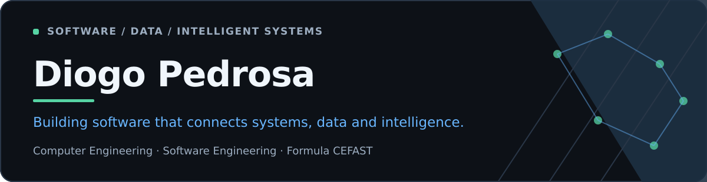
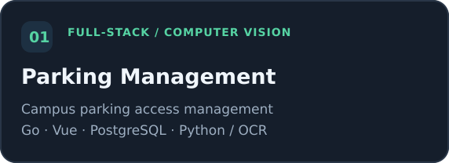
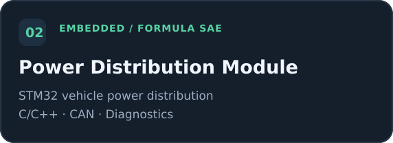
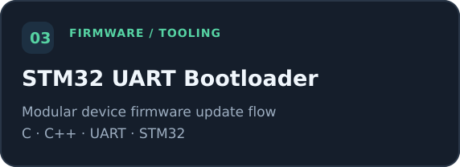
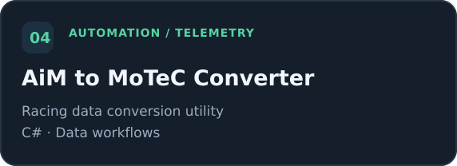
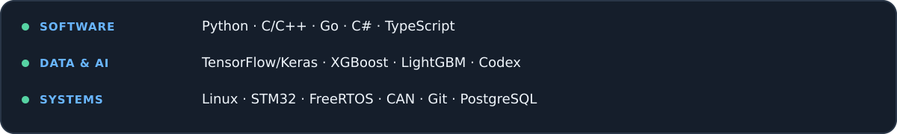

<!-- GitHub profile README for github.com/Diogo-Pedrosa -->
<picture>
  <source media="(prefers-color-scheme: light)" srcset="./assets/hero-light.svg">
  
</picture>

  <a href="https://www.linkedin.com/in/diogo-pedrosa-miranda/">LinkedIn</a> &nbsp;·&nbsp;
  <a href="mailto:diogopmiranda2108@gmail.com">Email</a> &nbsp;·&nbsp;
  <a href="https://github.com/Diogo-Pedrosa">GitHub</a>

I'm a **Computer Engineering student at CEFET-MG** and a **Software Engineering Intern at S4E Tech**.
I enjoy turning real engineering problems into reliable software — from data pipelines and computer vision to embedded systems.

- **Currently:** Software engineering for computing platforms and remote-operation solutions in mining.
- **Previously:** Data Acquisition Lead at **Formula CEFAST**, working on vehicle telemetry, software and systems integration.
- **Exploring:** Machine learning, computer vision, generative AI and AI-assisted development with **OpenAI Codex**.

<picture>
  <source media="(prefers-color-scheme: light)" srcset="./assets/heading-projects-light.svg">
  
</picture>

<table>
  <tr>
    <td width="50%">
      <a href="https://github.com/santana-iago/estacionamento">
        <picture><source media="(prefers-color-scheme: light)" srcset="./assets/project-1-light.svg"></picture>
      </a>
    </td>
    <td width="50%">
      <a href="https://github.com/Diogo-Pedrosa/Cefast-PDM">
        <picture><source media="(prefers-color-scheme: light)" srcset="./assets/project-2-light.svg"></picture>
      </a>
    </td>
  </tr>
  <tr>
    <td width="50%">
      <a href="https://github.com/Diogo-Pedrosa/stm32-uart-bootloader">
        <picture><source media="(prefers-color-scheme: light)" srcset="./assets/project-3-light.svg"></picture>
      </a>
    </td>
    <td width="50%">
      <a href="https://github.com/Diogo-Pedrosa/Aim_2_MoTeC">
        <picture><source media="(prefers-color-scheme: light)" srcset="./assets/project-4-light.svg"></picture>
      </a>
    </td>
  </tr>
</table>

**Parking automation for CEFET-MG** — Collaborative academic project developed in response to the institution's operational needs, with input from its IT department. It integrates a Go backend, Vue frontend, PostgreSQL database and an experimental Python computer-vision workflow for license plate recognition. I contributed software improvements and integration work using GitHub pull requests and Codex-assisted development. **Institutional deployment is still pending validation.**

**Telemetry & data automation** — At Formula CEFAST, I built scripts that process acquisition logs and produce analysis-ready plots and signals, reducing manual steps and helping the team evaluate vehicle setup parameters.

**Machine learning** — My academic work includes tabular classification experiments using XGBoost / LightGBM (Porto Seguro Safe Driver Prediction) and image-classification studies with CNNs. Additional image-classification experiments are in progress; repositories and reproducible results will be linked as they become public.

<picture>
  <source media="(prefers-color-scheme: light)" srcset="./assets/heading-stack-light.svg">
  
</picture>
<picture>
  <source media="(prefers-color-scheme: light)" srcset="./assets/stack-light.svg">
  
</picture>

---

Based in Belo Horizonte, Brazil · Open to learning, building, and collaborating on software and AI projects.
# Diogo-Pedrosa
